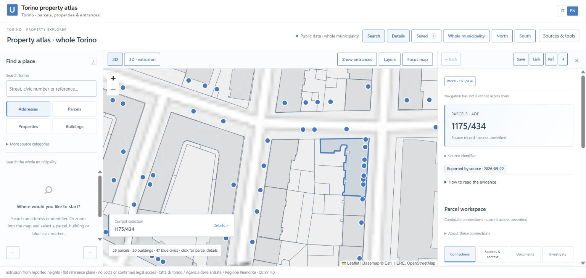

# Torino Parcels & Energy Atlas

Explore cadastral parcels, buildings and civic addresses across Turin. The atlas brings their source records into one map and shows the evidence behind proposed connections. The interface is available in Italian and English.

[Open the atlas](https://daudee215.github.io/torino-units-map/) · [Open San Donato parcel 1175/434](https://daudee215.github.io/torino-units-map/#record=cadastre%3AL219_117500.434)



## Explore a parcel

1. Open the San Donato example or search for an address or cadastral reference.
2. In the details panel, compare the connections and source context for the selected record.
3. Select a blue civic marker to inspect its parcel connection. If the evidence supports several candidates, choose a candidate to open its details. The map labels current access as unverified.

## Run locally

Clone the repository and serve the published files with Python 3.

```bash
git clone https://github.com/daudee215/torino-units-map.git
cd torino-units-map
python -m http.server 8765 --bind 127.0.0.1
```

Open [localhost:8765](http://localhost:8765/) in your browser. On Windows, `py -m http.server 8765 --bind 127.0.0.1` is equivalent. Basemap tiles and Street View use external services.

## Data and methods

The public atlas draws on cadastral cartography from Agenzia delle Entrate, civic and building data from Città di Torino and Regione Piemonte, and contextual sources including ANNCSU and Istat. [Source attribution](SOURCE_ATTRIBUTION.md) lists dataset versions, licences and processing details.

Connections reflect the available source evidence. Coverage varies by location. The map includes modelled energy scenarios and reports uncertainty around property links and current access.

## Release

The public atlas is version [2.16.0](https://github.com/daudee215/torino-units-map/tree/v2.16.0). See [release history](RELEASES.md) for the published changes.
